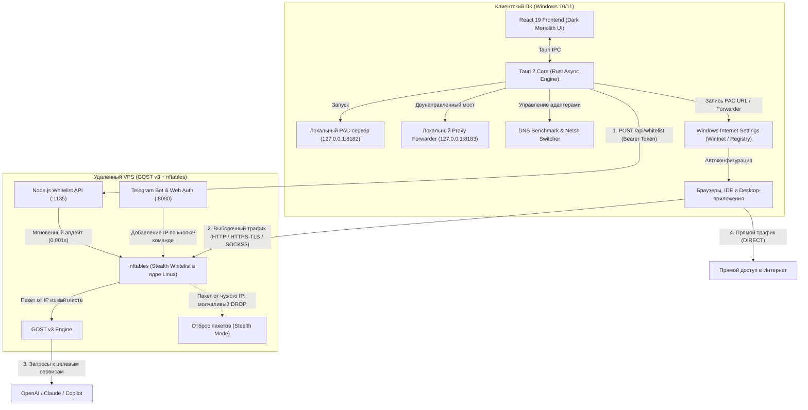

# Proxy Router Desktop

<div align="center">

-black?style=flat-square)


**Высокопроизводительный Windows-клиент для выборочного проксирования (Split Tunneling) доменов и процессов.**  
Поддержка протоколов **HTTP**, **HTTPS (TLS)**, **SOCKS5**, встроенный DNS-бенчмарк и защита доступа через ядро Linux (**nftables + GOST v3**).

[Релизы](https://github.com/D1verlin/ProxyRouterDesktop/releases) • [Быстрый деплой сервера (GOST v3)](deploy-gost/README.md) • [Сообщить об ошибке](https://github.com/D1verlin/ProxyRouterDesktop/issues)

</div>

---

## Что это и зачем

**Proxy Router Desktop** решает проблему стабильного и быстрого доступа к заблокированным и региональным веб-сервисам (OpenAI ChatGPT, Anthropic Claude, Google Gemini, GitHub Copilot, Midjourney и др.), не замедляя весь интернет-трафик компьютера.

В отличие от классических VPN-клиентов, которые перенаправляют абсолютно весь сетевой трафик через удаленный сервер (что создает лаги в онлайн-играх, снижает скорость торрентов и блокирует доступ к локальным российским ресурсам вроде Госуслуг и банков), Proxy Router маршрутизирует через защищенный прокси **только указанные домены и приложения**, оставляя весь остальной трафик прямым (`DIRECT`).

---

## Архитектура системы



---

## Ключевые возможности

### 1. Многопротокольный апстрим-прокси
Клиент поддерживает мгновенное переключение между тремя протоколами проксирования:
* **HTTP CONNECT** (по умолчанию, порт `3128`) — проверенный стандарт для маршрутизации трафика.
* **HTTPS / TLS CONNECT** (порт `8443`) — зашифрованный туннель между ПК и вашим VPS. Скрывает SNI и заголовки от систем глубокого анализа пакетов (DPI/ТСПУ) провайдеров. Поддерживает самоподписанные сертификаты (опция *«Игнорировать ошибки TLS»*).
* **SOCKS5** (порт `1080`) — бинарный протокол с полной поддержкой RFC 1928, минимальным сетевым оверхедом и высокой пропускной способностью.

### 2. Локальный форвардер и PAC-сервер (Rust)
* **Локальный PAC-сервер (`127.0.0.1:8182/proxy.pac`)**: динамически генерирует PAC-скрипт с правилами фильтрации доменов на лету.
* **Локальный Proxy Forwarder (`127.0.0.1:8183`)**: асинхронный двунаправленный мост на базе `tokio` и `native-tls`. Позволяет направлять трафик системного прокси напрямую через локальный порт, устраняя задержки парсинга PAC и сетевые таймауты Windows.

### 3. DNS-бенчмарк и мгновенное переключение
* Встроенный тест задержки (ping/latency) до **8 ведущих защищенных DNS-провайдеров**: Cloudflare, Google DNS, Quad9, AdGuard DNS, OpenDNS, DNS.WATCH, CleanBrowsing, Control D.
* Применение выбранного DNS в 1 клик через `netsh` на активных сетевых адаптерах (Wi-Fi, Ethernet).
* Резервное копирование предыдущих настроек и кнопка мгновенного отката к системным настройкам (DHCP / Автоматически).

### 4. Защита сервера: GOST v3 + nftables Stealth Whitelist
* **Потребление ОЗУ на сервере**: ~**15 МБ** (вместо 250–350 МБ у классического Squid).
* **Мгновенный вайтлист**: добавление IP-адреса клиента в хэш-таблицу ядра Linux `nftables` занимает **0.001 секунды** без перезагрузки служб и без обрыва активных соединений.
* **Режим невидимки (Stealth / DROP)**: неавторизованные запросы молча отбрасываются фаерволом на уровне сетевых пакетов. Для сетевых сканеров (Shodan, Censys) и ботов порты прокси выглядят полностью выключенными.
* **Telegram-бот**: привязанный бот позволяет добавлять IP-адрес со смартфона в 1 клик или через защищенную веб-страницу `/add-my-ip`.

### 5. Управление процессами и CLI
* **Проксирование приложений (.exe)**: запуск выбранных программ с изоляцией и мониторингом их состояния в реальном времени.
* **Экспорт системных переменных окружения**: копирование команд настройки `HTTP_PROXY`, `HTTPS_PROXY` и `ALL_PROXY` для PowerShell, Command Prompt (CMD), Git Bash и WSL в один клик.

---

## Быстрый старт

### Установка готового приложения
1. Перейдите в раздел [Релизы (Releases)](https://github.com/D1verlin/ProxyRouterDesktop/releases).
2. Скачайте нужный установщик:
   - **`Proxy Router Desktop_1.0.17_x64-setup.exe`** (рекомендуемый инсталлятор)
   - или **`Proxy Router Desktop_1.0.17_x64_en-US.msi`** (пакет Windows Installer)
3. Запустите инсталлятор и следуйте подсказкам на экране.

---

## Деплой серверной части

Вся серверная инфраструктура упакована в готовый комплект автоматического развертывания в папке [`deploy-gost/`](deploy-gost/README.md).

### Установка на Ubuntu / Debian за 1 минуту:
```bash
# 1. Скопируйте папку на VPS:
scp -r ./deploy-gost root@ВАШ_IP_СЕРВЕРА:/root/deploy-gost

# 2. Подключитесь по SSH и запустите установщик:
ssh root@ВАШ_IP_СЕРВЕРА
cd /root/deploy-gost
chmod +x install.sh ip_manager.sh
./install.sh
```

Скрипт автоматически:
1. Установит GOST v3 и `nftables`.
2. Мягко остановит и отключит старый Squid (освободив порт `3128`).
3. Мигрирует все существующие разрешенные IP в новую таблицу ядра.
4. Сгенерирует TLS-сертификаты для защищенного HTTPS-прокси на порту `8443`.
5. Настроит и запустит systemd-юниты: `gost.service`, `whitelist-api.service` и `tg-bot.service`.

> [!NOTE]
> Сгенерированный или настроенный токен авторизации API находится в файле `/opt/proxy-whitelist-api/tokens.json` на сервере. Вставьте его в поле **«Токен авторизации»** в настройках Proxy Router Desktop.

---

## Сборка из исходников

### Требования к окружению
- **Node.js** ≥ 18
- **Rust & Cargo** (установка через [rustup.rs](https://rustup.rs))
- **Visual Studio C++ Build Tools** (компоненты MSVC для Windows)

### 1. Клонирование репозитория
```bash
git clone https://github.com/D1verlin/ProxyRouterDesktop.git
cd ProxyRouterDesktop
```

### 2. Установка зависимостей и запуск в dev-режиме
```bash
cd proxy-router-desktop
npm install
npm run tauri dev
```

### 3. Сборка релизного инсталлятора
```bash
npm run tauri build
```
Готовые исполняемые файлы и установщики будут сгенерированы в каталоге:  
`proxy-router-desktop/src-tauri/target/release/bundle/`

---

## Структура репозитория

```
ProxyRouterDesktop/
├── .github/workflows/          # GitHub Actions CI/CD (автоматическая сборка релизов)
├── deploy-gost/                # Полный серверный стек: GOST v3 + nftables + API + TG-бот
│   ├── gost.yaml               # Конфигурация портов GOST (HTTP :3128, TLS :8443, SOCKS5 :1080)
│   ├── nftables.conf           # Конфигурация ядра Linux со скрытым вайтлистом (Stealth DROP)
│   ├── ip_manager.sh           # Высокоскоростное управление хэш-сетом nftables (0.001s)
│   ├── index.js                # Whitelist REST API (:1135) с поддержкой токенов
│   ├── install.sh              # Скрипт автоматического развертывания в 1 клик
│   ├── systemd/                # Юниты gost.service, whitelist-api.service, tg-bot.service
│   └── tg-bot/                 # Telegram-бот с веб-авторизацией /add-my-ip
├── proxy-router-desktop/       # Клиентское Windows-приложение (Tauri 2 + React 19 + Rust)
│   ├── src/                    # Интерфейс React (Dashboard, Rules, Settings, DNS Benchmark)
│   ├── src-tauri/              # Нативный бэкенд на Rust
│   │   ├── src/proxy.rs        # PAC-сервер, Forwarder (HTTP/TLS/SOCKS5), WinInet интеграция
│   │   ├── src/dns.rs          # Мониторинг и переключение сетевых DNS-адаптеров
│   │   └── Cargo.toml          # Зависимости Rust (tokio, native-tls, tauri 2)
│   └── package.json            # Зависимости и скрипты сборки интерфейса
├── server/                     # Устаревший серверный стек на базе Squid (архив)
└── README.md                   # Главная документация проекта
```

---

## Лицензия

Проект распространяется под лицензией [MIT](LICENSE).
