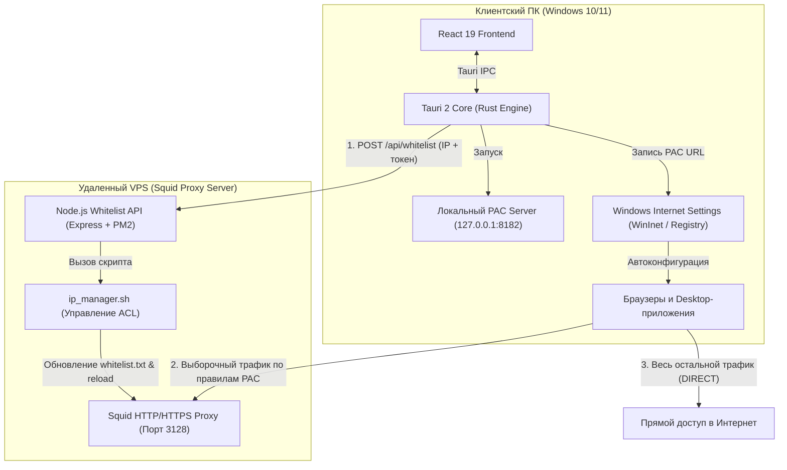

# Proxy Router Desktop

<div align="center">

-black?style=flat-square)


**Высокопроизводительный Windows-клиент для выборочного проксирования (Split Tunneling) доменов и процессов.**

[Релизы](https://github.com/D1verlin/ProxyRouterDesktop/releases) • [Документация сервера](server/README.md) • [Сообщить об ошибке](https://github.com/D1verlin/ProxyRouterDesktop/issues)

</div>

---

## Что это и зачем

**Proxy Router Desktop** решает проблему доступа к заблокированным и региональным веб-сервисам (OpenAI, Anthropic Claude, Google Gemini, GitHub Copilot и др.), не замедляя весь интернет-трафик компьютера.

В отличие от классических VPN-клиентов, которые перенаправляют абсолютно весь трафик через удаленный сервер и увеличивают пинг для локальных ресурсов, Proxy Router маршрутизирует через прокси **только указанные домены и приложения**, оставляя остальной трафик прямым (DIRECT).

---

## Как это работает

1. **Локальный PAC-сервер**: встроенный легковесный HTTP-сервер на Rust (`http://127.0.0.1:8182/proxy.pac`) динамически генерирует PAC-скрипт на основе вашего списка целевых сайтов.
2. **Интеграция с реестром Windows (WinInet)**: PAC URL записывается в системные параметры Windows и мгновенно активируется через WinInet API без перезагрузки системы и браузеров.
3. **Белый список на VPS**: приложение определяет публичный IP-адрес клиента и передает его серверному REST API по Bearer-токену, динамически обновляя списки доступа (ACL) в Squid.

---

## Архитектура системы



---

## Основные возможности

- **Выборочная маршрутизация сайтов**: гибкий список доменов с поддержкой масок (`*.domain.com`) и предустановленные профили для популярных AI-сервисов.
- **Управление процессами (.exe)**: запуск выбранных программ с проксированием и мониторинг их состояния в реальном времени.
- **Интеграция с терминалами (CLI)**: экспорт системных переменных `HTTP_PROXY` и `HTTPS_PROXY` в один клик для PowerShell и Command Prompt (CMD).
- **Автоматический Whitelist на VPS**: определение внешнего IP и синхронизация с ACL прокси-сервера.
- **Импорт и экспорт конфигурации**: перенос настроек через компактную строку `pr://...` или файл `.json`.
- **Встроенная проверка обновлений**: проверка новых релизов через GitHub API непосредственно из приложения.

---

## Быстрый старт

### Установка готового приложения
1. Перейдите в раздел [Релизы (Releases)](https://github.com/D1verlin/ProxyRouterDesktop/releases).
2. Скачайте нужный установщик:
   - **`Proxy Router Desktop_x64-setup.exe`** (стандартный установщик)
   - или **`Proxy Router Desktop_x64_en-US.msi`** (пакет Windows Installer)
3. Запустите инсталлятор и следуйте подсказкам на экране.

---

## Сборка из исходников

### Требования к окружению
- **Node.js** ≥ 18
- **Rust & Cargo** (установка через [rustup.rs](https://rustup.rs))
- **Visual Studio C++ Build Tools** (компоненты MSVC для Windows)

### 1. Клонирование репозитория
```bash
git clone https://github.com/D1verlin/ProxyRouterDesktop.git
cd ProxyRouterDesktop
```

### 2. Установка зависимостей и запуск в dev-режиме
```bash
cd proxy-router-desktop
npm install
npm run tauri dev
```

### 3. Сборка релизного инсталлятора
```bash
npm run tauri build
```
Готовые исполняемые файлы и установщики будут сгенерированы в каталоге:  
`proxy-router-desktop/src-tauri/target/release/bundle/`

---

## Деплой серверной части

Серверный компонент разворачивается на Ubuntu/Debian VPS с установленным Squid.  
Подробная пошаговая инструкция доступна в файле [server/README.md](server/README.md).

Краткий алгоритм:
1. Скопируйте файлы каталога `server/` на ваш сервер.
2. Настройте токен авторизации `AUTH_TOKEN`.
3. Установите зависимости и запустите службу через PM2:
```bash
cd server
npm install
pm2 start ecosystem.config.js --env production
pm2 save
```

---

## Структура репозитория

```
ProxyRouterDesktop/
├── .github/workflows/          # CI/CD: автосборка инсталляторов и релизы GitHub Actions
├── proxy-router-desktop/       # Клиентское приложение (Tauri + React + Rust)
│   ├── src/                    # Фронтенд на React 19 (страницы, компоненты, стейт)
│   ├── src-tauri/              # Нативный бэкенд на Rust (WinInet, PAC-сервер, процессы)
│   └── package.json            # Зависимости и скрипты сборки интерфейса
├── server/                     # Серверный микросервис для VPS (Node.js + Squid ACL)
│   ├── index.js                # REST API (авторизация и whitelist IP)
│   ├── ip_manager.sh           # Bash-скрипт обновления ACL Squid
│   └── ecosystem.config.js     # Конфигурация PM2
└── README.md                   # Главная документация проекта
```

---

## Лицензия

Проект распространяется под лицензией [MIT](LICENSE).
