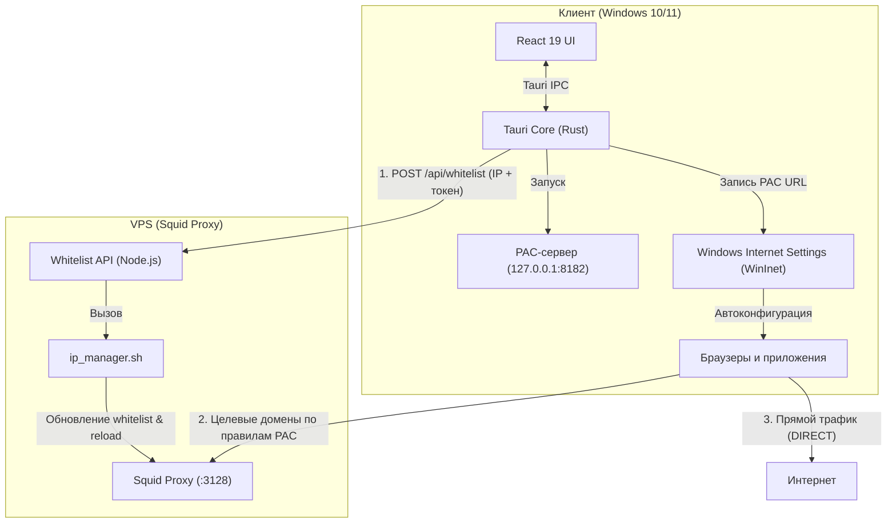

# Proxy Router Desktop

<div align="center">

-black?style=flat-square)


**Windows-клиент для выборочного проксирования (Split Tunneling) доменов и процессов.**

[Релизы](https://github.com/D1verlin/ProxyRouterDesktop/releases) • [Серверная часть](../server/README.md) • [Баг-трекер](https://github.com/D1verlin/ProxyRouterDesktop/issues)

</div>

---

## Что это и зачем

**Proxy Router Desktop** решает проблему доступа к заблокированным и региональным сервисам (OpenAI, Anthropic Claude, Google Gemini, GitHub Copilot и др.), не замедляя весь интернет-трафик системы.

В отличие от стандартных VPN-клиентов, перенаправляющих весь сетевой поток через удаленный сервер, приложение маршрутизирует через прокси **только указанные домены и исполняемые файлы**, оставляя остальной трафик прямым (DIRECT).

---

## Как это работает

1. **Локальный PAC-сервер**: нативный движок на Rust запускает HTTP-сервер (`http://127.0.0.1:8182/proxy.pac`), динамически формирующий правила маршрутизации.
2. **Интеграция с Windows (WinInet)**: URL PAC-файла прописывается в реестр Windows и мгновенно активируется через WinInet API без необходимости перезагружать систему или браузеры.
3. **Белый список на VPS**: клиент определяет внешний IP пользователя и отправляет его на серверный API по Bearer-токену, добавляя в список разрешенных IP для Squid.

---

## Архитектура



---

## Основные возможности

- **Выборочный роутинг сайтов**: добавление пользовательских доменов (включая wildcards `*.domain.com`), готовые пресеты для популярных AI-сервисов.
- **Проксирование приложений (`.exe`)**: запуск программ с системными прокси-переменными и мониторинг их процессов в реальном времени.
- **Терминалы (CLI)**: экспорт переменных `HTTP_PROXY` / `HTTPS_PROXY` в один клик для PowerShell и CMD.
- **VPS Whitelist**: автообновление белого списка IP на удаленном сервере через REST API.
- **Импорт / Экспорт профилей**: перенос настроек через компактную строку `pr://...` или файл `.json`.

---

## Быстрый старт

### Установка готового релиза
Скачайте актуальный установщик со страницы [Releases](https://github.com/D1verlin/ProxyRouterDesktop/releases):
- `Proxy Router Desktop_x64-setup.exe` (NSIS-установщик)
- `Proxy Router Desktop_x64_en-US.msi` (MSI-пакет)

### Сборка из исходников

**Требования:**
- **Node.js** ≥ 18
- **Rust** (MSVC toolchain, устанавливается через [rustup.rs](https://rustup.rs))
- **Visual Studio C++ Build Tools**

**Запуск в dev-режиме:**
```bash
# Из папки proxy-router-desktop
npm install
npm run tauri dev
```

**Сборка инсталлятора:**
```bash
npm run tauri build
```
Готовые бинарники и инсталляторы будут в `src-tauri/target/release/bundle/`.

---

## Серверная часть (VPS)

Серверный компонент управляет белым списком IP для прокси-сервера Squid. Инструкция по установке и настройке Node.js API и Squid находится в [../server/README.md](../server/README.md).

---

## Лицензия

MIT License.
